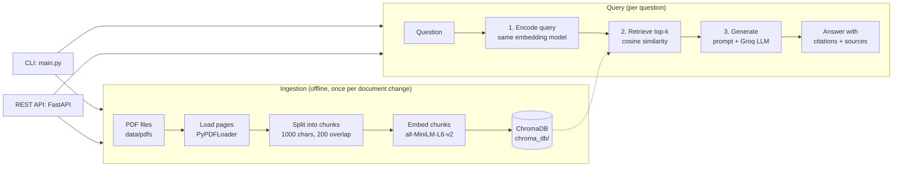

# Naive RAG over PDF files

A naive (standard) Retrieval-Augmented Generation pipeline that answers questions about your PDF documents and cites its sources.

It follows the classic three-step process with no query rewriting, filtering or re-ranking:

1. **Query encoding**: the question is embedded with the same model used for the document chunks.
2. **Retrieval**: the top-k most similar chunks are fetched from ChromaDB.
3. **Generation**: the chunks are put into a prompt, and a Groq-hosted LLM writes an answer that cites them, for example `[Employee_Benefits_Guide_2027.pdf, p. 6]`.

You can use it from the command line or through a REST API (FastAPI), for example from Postman.

## High-level flow



## Tech stack

| Layer | Technology |
|---|---|
| Language | Python 3.10+ (developed and tested on 3.12) |
| Orchestration | [LangChain](https://python.langchain.com/) (LCEL chains) |
| Vector database | [ChromaDB](https://www.trychroma.com/), persisted locally, cosine distance |
| Embeddings | `sentence-transformers/all-MiniLM-L6-v2`, run locally through `langchain-huggingface`, because Groq has no embeddings API |
| LLM | [Groq](https://console.groq.com/), model `openai/gpt-oss-120b`, through `langchain-groq` |
| Data source | PDF files, parsed with `pypdf` (`PyPDFLoader`) |
| REST API | FastAPI + Uvicorn (`python-multipart` for file uploads) |
| Configuration | `.env` file, loaded with `python-dotenv` |
| Tests | pytest |

## Folder structure

```
rag-naive/
├── main.py                     # CLI: ingest, ask, chat, serve
├── rag_naive/                  # the package
│   ├── config.py               # Settings loaded from .env
│   ├── vectorstore.py          # embedding model + ChromaDB factories
│   ├── pipeline.py             # NaiveRAG: retrieval -> generation (LCEL)
│   ├── ingestion/              # load PDFs, split, embed, store
│   ├── retrieval/              # top-k retriever, citation labels, context formatting
│   ├── generation/             # prompt, Groq LLM, citation normalization
│   └── api/                    # FastAPI app, service layer, request/response schemas
├── tests/                      # unit tests (mirror the package layout) + e2e/
├── data/pdfs/                  # source PDFs (sample HR/benefits policies included)
├── chroma_db/                  # vector index, created by ingestion (git-ignored)
├── postman_collection/         # Postman collection with one request per API endpoint
├── requirements.txt            # runtime dependencies
├── requirements-dev.txt        # + pytest
├── pyproject.toml              # pytest configuration
└── .env.example                # configuration template
```

## Module documentation

Each part of the pipeline has its own README:

| Module | What it does |
|---|---|
| [Ingestion](rag_naive/ingestion/README.md) | Load PDFs, split them into chunks, embed and upsert them into ChromaDB |
| [Retrieval](rag_naive/retrieval/README.md) | Top-k similarity search, citation labels and context formatting |
| [Generation](rag_naive/generation/README.md) | Prompt rules, Groq LLM setup, citation normalization, streaming |
| [REST API](rag_naive/api/README.md) | Endpoints, Postman usage, errors, configuration and design notes |

## Setup on your machine

### Prerequisites

- **Python 3.10 or newer**: check with `python --version`.
- **Git**
- **A Groq API key**: create one for free at [console.groq.com/keys](https://console.groq.com/keys).
- About 1 GB of free disk space for PyTorch and the embedding model.

### 1. Clone the repository

```
git clone https://github.com/Aarzoo-Agentic-AI/rag-naive.git
cd rag-naive
```

### 2. Create and activate a virtual environment

The virtual environment keeps this project's packages separate from your system Python. Create it once:

```
python -m venv .venv
```

Activate it in every new terminal before you work on the project:

| Shell | Command |
|---|---|
| Windows PowerShell | `.venv\Scripts\Activate.ps1` |
| Windows Command Prompt | `.venv\Scripts\activate.bat` |
| Git Bash (Windows) | `source .venv/Scripts/activate` |
| macOS / Linux | `source .venv/bin/activate` |

When it's active, your prompt starts with `(.venv)`. Run `deactivate` to leave it.

> **PowerShell says "running scripts is disabled on this system"?** Allow local scripts for your user once with `Set-ExecutionPolicy -Scope CurrentUser RemoteSigned`, then activate again.
>
> **VS Code:** press `Ctrl+Shift+P`, choose **Python: Select Interpreter**, then pick `.venv`. New terminals then activate it automatically.

### 3. Install dependencies

```
python -m pip install --upgrade pip
pip install -r requirements.txt        # to run the app
pip install -r requirements-dev.txt    # to also run the tests
```

### 4. Configure your environment

Copy the template, then put your Groq key in `.env`:

```
copy .env.example .env        # Windows
cp .env.example .env          # macOS / Linux
```

```
GROQ_API_KEY=your-groq-api-key
```

`.env` must be in the project root, next to `main.py`. It's git-ignored, so your key is never committed. All other settings have sensible defaults:

| Variable | Default | Purpose |
|---|---|---|
| `GROQ_API_KEY` | (required) | Groq API key. Ingestion and retrieval work without it, answering doesn't |
| `GROQ_MODEL` | `openai/gpt-oss-120b` | Groq chat model |
| `GROQ_TEMPERATURE` | `0.0` | Sampling temperature |
| `EMBEDDING_MODEL` | `sentence-transformers/all-MiniLM-L6-v2` | Local embedding model |
| `PDF_DIR` | `data/pdfs` | Where PDFs are read from |
| `CHROMA_DIR` | `chroma_db` | Where the vector index is stored |
| `CHROMA_COLLECTION` | `naive_rag` | Chroma collection name |
| `CHUNK_SIZE` / `CHUNK_OVERLAP` | `1000` / `200` | Chunk length and overlap, in characters |
| `TOP_K` | `4` | Chunks retrieved per question |
| `MAX_UPLOAD_MB` | `50` | Maximum size of a PDF uploaded through the API |

Relative paths are resolved from the project root, so commands work from any folder.

> If you change `EMBEDDING_MODEL`, `CHUNK_SIZE` or `CHUNK_OVERLAP`, re-index with `python main.py ingest --reset`.

## Running

Run these from the project root with the virtual environment active.

### 1. Index your PDFs

Put PDFs in `data/pdfs/` (sample policies are already there), then:

```
python main.py ingest                          # index everything in data/pdfs
python main.py ingest path\to\file.pdf         # index one file or folder
python main.py ingest --reset                  # clear the index first (after deleting or editing PDFs)
```

The first run downloads the embedding model (about 90 MB), so it takes longer. Re-running `ingest` updates existing chunks rather than duplicating them.

### 2. Ask questions

```
python main.py ask "How many days of paid vacation do employees get?"
python main.py chat                            # interactive loop with streamed answers; type exit to quit
```

Example output:

```
Employees receive paid time off (PTO) that serves as vacation days, and the amount varies by length of service:

- **0–2 years of service:** 15 days of PTO
- **3–5 years of service:** 20 days of PTO
- **6+ years of service:** 25 days of PTO

[Employee_Benefits_Guide_2027.pdf, p. 6]

Sources:
  - [Employee_Benefits_Guide_2027.pdf, p. 6]
  - [HR_Policy_Handbook_2027.pdf, p. 4]
  - [HR_Policy_Handbook_2027.pdf, p. 8]
  - [HR_Policy_Handbook_2027.pdf, p. 5]
```

A warning about unauthenticated requests to the HF Hub is harmless. It only means the embedding model is checked or downloaded without a Hugging Face token.

Add `-v` before the command, for example `python main.py -v ask "..."`, to see info logging.

### 3. Run the REST API

```
python main.py serve                           # http://127.0.0.1:8000
python main.py serve --port 9000 --reload      # custom port, auto-reload while developing
```

Open [http://127.0.0.1:8000/docs](http://127.0.0.1:8000/docs) to try every endpoint in the browser, or use Postman (see the next section).

| Method | Path | Purpose |
|---|---|---|
| `GET` | `/health` | Status, configured models, indexed chunk count |
| `POST` | `/ingest` | Index PDFs already in `PDF_DIR` |
| `POST` | `/ingest/upload` | Upload PDFs (form-data, field `files`) and index them |
| `GET` | `/documents` | Indexed files and their chunk counts |
| `POST` | `/retrieve` | Top-k chunks only, with no LLM call |
| `POST` | `/query` | Answer with cited sources |
| `POST` | `/query/stream` | Answer streamed as Server-Sent Events |

Send JSON bodies with the header `Content-Type: application/json`. Any other content type returns `422`. See the [API README](rag_naive/api/README.md) for request and response examples and error codes.

### 4. Use the Postman collection

[postman_collection/rag-naive.postman_collection.json](postman_collection/rag-naive.postman_collection.json) is a ready-made Postman collection, named **RAG**, with one request per endpoint.

**Import it:**

1. Start the API with `python main.py serve`.
2. In Postman, choose **Import**, then drag in `postman_collection/rag-naive.postman_collection.json` or browse to it.
3. Open the **RAG** collection in the sidebar.

Every request points at `http://127.0.0.1:8000`. If you run the server on another port, for example with `--port 9000`, change the port in each request URL.

**Requests:**

| Request | Method and path | Body | Notes |
|---|---|---|---|
| `health` | `GET /health` | none | Check `indexed_chunks` and `llm_configured` first |
| `ingestion` | `POST /ingest` | `{"reset": true}` | Re-indexes every PDF in `data/pdfs`. `reset: true` clears the index first; use `false` to just add or update |
| `ingestion/upload` | `POST /ingest/upload` | form-data, key `files` (type **File**) | Uploads PDFs into `data/pdfs` and indexes them |
| `documents` | `GET /documents` | none | Files in the index and on disk, with chunk counts |
| `retrieve` | `POST /retrieve` | `{"question": "How many PTO days do employees get?", "top_k": 2}` | Chunks only, with no LLM call. Works without a Groq key |
| `query` | `POST /query` | `{"question": "Who is eligible for the 401(k) match and what is the match percentage?"}` | Full answer with cited sources |
| `query/stream` | `POST /query/stream` | same as `query` | Streams the answer as Server-Sent Events: `sources`, then `token` events, then `done` |

**Suggested order on a fresh setup:** `health`, then `ingestion`, then `documents`, then `retrieve`, then `query`, then `query/stream`.

**Things to know:**

- **JSON requests** (`ingestion`, `retrieve`, `query`, `query/stream`) need the body set to **raw → JSON**, which sends `Content-Type: application/json`. A different content type, such as `text/event-stream`, returns `422 Unprocessable Entity`.
- **Choose files before sending `ingestion/upload`.** The collection ships with no files selected. In **Body → form-data**, click the `files` value and pick one or more PDFs, for example from `data/pdfs`.
- **Don't add a `Content-Type` header to `ingestion/upload`.** Postman generates `multipart/form-data` with the right boundary itself. A hand-set `Content-Type: application/json` returns `422` with `"loc": ["body", "files"], "msg": "Field required"`.
- **Streaming in Postman:** `query/stream` shows each event as it arrives in the response pane. Use `query` if you only want the final answer.
- You can also build a collection straight from the running server: **Import → Link →** `http://127.0.0.1:8000/openapi.json`. It always matches the current endpoints, but has no example questions.

## Tests

```
pytest                    # unit tests: fast, offline, no API key needed
pytest tests/api          # one area only
pytest -m e2e             # end-to-end: real embedding model + real Groq API (needs GROQ_API_KEY)
```

Unit tests use fake embeddings and a fake LLM. They work in temporary folders, so they never touch your `data/pdfs` or `chroma_db`. The end-to-end tests are opt-in. They generate their own PDFs and index them into a temporary folder.

## Limitations

This is deliberately a *naive* RAG, so it has the usual weaknesses:

- **One retrieval per question.** A question covering several topics, for example "vacation days and the 401(k) match", may only retrieve chunks about one of them. The model then says it doesn't know the other part. Ask separately, or raise `TOP_K`.
- **No re-ranking or filtering.** Whatever is most similar is sent to the model, even when it's only loosely related.
- **Text-only PDFs.** Scanned PDFs (images with no text layer) need OCR first, and tables lose their layout.
- **The API has no authentication.** It binds to `127.0.0.1` by default; don't expose it on a network as is. See the security notes in the [API README](rag_naive/api/README.md#security).

## Troubleshooting

| Problem | Fix |
|---|---|
| `GROQ_API_KEY is not set` | Create `.env` in the project root (not inside `rag_naive/`) and set the key |
| `model_not_found` / `model_decommissioned` from Groq | The model was retired. Set `GROQ_MODEL` to a current one from [console.groq.com/docs/models](https://console.groq.com/docs/models) |
| The answer is always "I don't know based on the provided documents." | Nothing is indexed yet (run `python main.py ingest`), or the answer isn't in the retrieved chunks (raise `TOP_K`) |
| Answers cite PDFs you deleted | Run `python main.py ingest --reset` |
| `No module named rag_naive` / `fastapi` | Activate the virtual environment and run from the project root |
| `422 Unprocessable Entity` from the API | JSON endpoints: send the body as raw JSON with `Content-Type: application/json`. `/ingest/upload`: remove any hand-set `Content-Type` header and use form-data with key `files` |
